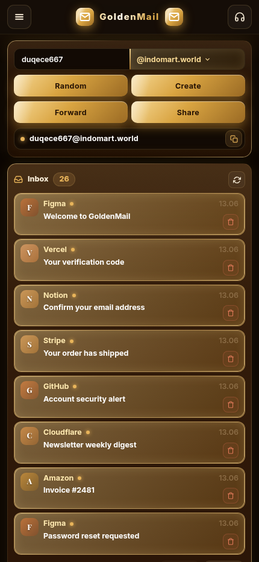
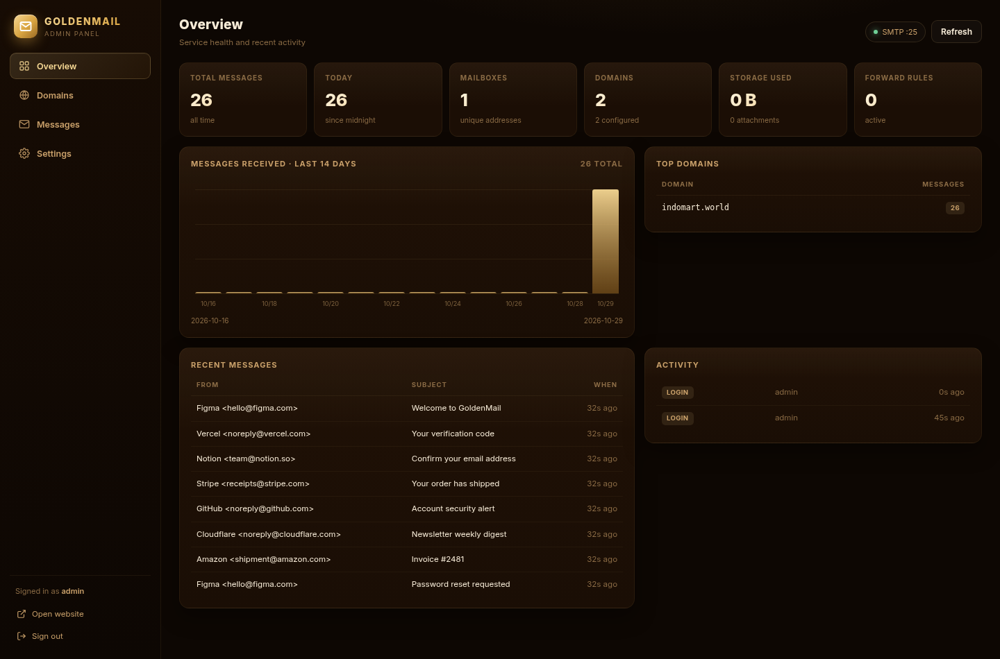

# GoldenMail

A complete, self-hosted disposable-email (temp mail) system with a golden/dark
mobile-first inbox UI and a protected admin panel for domains, stats and settings.

Built as a faithful, working clone of `goldenmail.indomart.world` — same visual
design and public API shape, but with a real backend you own.

| Mailbox | Admin panel |
|---|---|
|  |  |

```
┌─────────────┐   SMTP :25    ┌──────────────┐   SQLite    ┌─────────────┐
│  Internet   │ ────────────► │  Node server │ ──────────► │   data/     │
└─────────────┘               │  + mailparser│             └─────────────┘
                              │  + Express   │ ◄──── poll ──  Browser
                              └──────┬───────┘
                                     │ /admin
                              ┌──────▼───────┐
                              │  Admin panel │
                              └──────────────┘
```

## Features

**Public mailbox**
- Instant random or custom addresses on any configured domain
- Live inbox polling (configurable interval), new-mail chime
- HTML email rendering (sanitized), attachments, inline `cid:` images
- Pin / history lists, share links (`/share/user@domain`), forward-to-email rules
- Message delete, pagination, mobile drawer navigation — pixel-matched to the
  original UI

**Admin panel** (`/admin`)
- Session login (bcrypt + HttpOnly cookie + CSRF tokens + rate limiting)
- Dashboard: totals, today, mailboxes, storage, 14-day chart, top domains,
  recent messages, activity log, SMTP/relay status
- Domain manager: add / enable / disable / set default / delete, plus a live
  DNS check (MX, SPF, DMARC, mail-host A record)
- Message browser with search, domain filter, full preview in a sandboxed
  iframe, delete and CSV export
- Settings: branding, poll interval, retention, size limits, HTTP-ingest URL,
  outbound relay for forwarding, password change

**Mail ingest**
- Built-in SMTP server (no Postfix required) with per-recipient validation
- HTTP ingest fallback for hosts where port 25 is blocked (Cloudflare Email
  Workers, Postfix pipe, Mailgun routes)
- Optional STARTTLS, message/attachment size limits, automatic retention purge

## Requirements

- Node.js **22.5+** (uses the built-in `node:sqlite`; tested on Node 24)
- A domain with MX pointing at the server
- Port 25 reachable (or the HTTP-ingest fallback)
- Linux/macOS; Docker optional
- cPanel: Node.js app support (Passenger) + PHP 8 for the installer

## Quick start

### Option A — one-command installer (VPS / bare metal)

```bash
git clone https://github.com/ashyamctommy-eng/TEMP-MAIL-SRC.git goldenmail
cd goldenmail
chmod +x installer.sh
sudo ./installer.sh --domain example.com \
  --site-url https://mail.example.com \
  --mail-hostname mail.example.com \
  --admin-pass 'choose-a-strong-password'
```

The installer checks Node 22.5+, writes `.env`, installs dependencies, creates
the database and admin, grants the port-25 capability, and can install a
systemd service (`--systemd`). Run `./installer.sh --help` for all flags; run it
with no flags for an interactive prompt.

### Option B — manual

```bash
cd goldenmail
npm install
cp .env.example .env
# edit .env — at minimum set ADMIN_PASSWORD, MAIL_HOSTNAME, SITE_URL
npm start
```

The app loads `.env` itself, so `npm start` is enough (no `source` needed).

Open:

- Public site — <http://localhost:3000>
- Admin — <http://localhost:3000/admin>

On first boot the admin account is created from `ADMIN_USER` / `ADMIN_PASSWORD`.
If `ADMIN_PASSWORD` is empty, a random password is generated, printed once, and
written to `data/initial-admin.txt` (chmod 600). Delete that file after login.

Add your first domain in **Admin → Domains**. Nothing is accepted until a domain
is configured (unless `DEFAULT_DOMAIN` is set, which seeds one on first run).

### Option C — cPanel / shared hosting

Use the web/CLI installer and cPanel's **Setup Node.js App**:

```bash
cd ~/goldenmail
php installer.php --domain=example.com --site-url=https://mail.example.com \
  --mail-hostname=mail.example.com --admin-pass='choose-a-strong-password'
```

Then create the Node.js app with root `goldenmail`, startup file
`server/index.js`, Node 22.5+. Full guide, including the Cloudflare Email
Routing Worker for inbound mail (port 25 is unavailable on shared hosting):
**[docs/CPANEL.md](docs/CPANEL.md)**.

### Ports

| Port | Purpose |
|------|---------|
| 3000 | Web app, admin panel, API |
| 25   | Inbound SMTP (configurable with `SMTP_PORT`) |

Port 25 typically needs root or `CAP_NET_BIND_SERVICE`:

```bash
sudo setcap 'cap_net_bind_service=+ep' "$(which node)"
```

or run behind Docker (see below), or use `SMTP_PORT=2525` plus a firewall
redirect.

## DNS setup (required for real mail)

For each domain you add in the admin panel:

| Record | Name | Value | Purpose |
|--------|------|-------|---------|
| `A` | `mail.yourdomain.com` | your server IPv4 | mail host |
| `MX` | `yourdomain.com` | `mail.yourdomain.com` (priority 10) | deliver mail here |
| `TXT` | `yourdomain.com` | `v=spf1 mx ~all` | SPF |
| `TXT` | `_dmarc.yourdomain.com` | `v=DMARC1; p=none; rua=mailto:dmarc@yourdomain.com` | DMARC |
| `PTR` | server IP → `mail.yourdomain.com` | at your VPS provider | reverse DNS, improves deliverability |

Use the **DNS** button next to a domain in the admin panel to verify MX/SPF/DMARC
and the mail-host A record live.

> Receiving mail needs no DKIM. If you also send/forward mail, configure your
> relay provider's SPF/DKIM as they instruct.

### If port 25 is blocked (common on VPS/cloud)

Use the HTTP ingest endpoint instead. It accepts raw RFC822 mail:

```bash
curl -X POST "https://mail.example.com/api/ingest?to=user@yourdomain.com" \
  -H "X-Ingest-Secret: <secret from Admin → Settings>" \
  -H "Content-Type: message/rfc822" \
  --data-binary @message.eml
```

**Cloudflare Email Routing + Worker**

Point the domain's MX at Cloudflare, enable Email Routing, then deploy:

```js
export default {
  async email(message, env) {
    const raw = await new Response(message.raw).arrayBuffer();
    const url = `${env.INGEST_URL}?to=${encodeURIComponent(message.to)}`;
    const res = await fetch(url, {
      method: "POST",
      headers: {
        "Content-Type": "message/rfc822",
        "X-Ingest-Secret": env.INGEST_SECRET,
      },
      body: raw,
    });
    if (!res.ok) message.setReject("Mailbox unavailable");
  },
};
```

**Postfix pipe** (if you already run Postfix): map the domain in
`virtual_alias_maps` to a transport that pipes the message to `curl` against the
same endpoint, or set `virtual_transport = goldenmail` with a small pipe script.

## Installers

| File | Use it for | What it does |
|------|------------|--------------|
| `installer.sh` | VPS, Dedicated, LXC | Node check, `.env`, deps, DB + admin, `setcap` for port 25, optional systemd |
| `installer.php` | cPanel, DirectAdmin, any PHP host | Web wizard **and** CLI (`php installer.php ...`); `.env`, deps, DB + admin, cPanel instructions, self-delete |

Both are idempotent and never overwrite an existing admin unless you ask.

## Docker

```bash
cp .env.example .env    # set ADMIN_PASSWORD, SITE_URL, MAIL_HOSTNAME
docker compose up -d --build
```

The compose file publishes `3000` (web) and `25` (SMTP) and persists `./data`.
Inside the container the process runs as the unprivileged `node` user; binding
port 25 in a container is allowed by default.

## Reverse proxy (HTTPS)

Run the app on `127.0.0.1:3000` and terminate TLS with nginx:

```nginx
server {
    listen 443 ssl http2;
    server_name mail.example.com;

    ssl_certificate     /etc/letsencrypt/live/mail.example.com/fullchain.pem;
    ssl_certificate_key /etc/letsencrypt/live/mail.example.com/privkey.pem;

    client_max_body_size 30m;

    location / {
        proxy_pass http://127.0.0.1:3000;
        proxy_set_header Host              $host;
        proxy_set_header X-Real-IP         $remote_addr;
        proxy_set_header X-Forwarded-For   $proxy_add_x_forwarded_for;
        proxy_set_header X-Forwarded-Proto $scheme;
    }
}
```

Set `TRUST_PROXY=1` and `SECURE_COOKIES=1` in `.env` when behind TLS.

`SITE_URL` is only used for logs/metadata; share links are built from the
browser's origin, so they work on any hostname.

## systemd

```ini
[Unit]
Description=GoldenMail temp mail
After=network.target

[Service]
Type=simple
WorkingDirectory=/opt/goldenmail
EnvironmentFile=/opt/goldenmail/.env
ExecStart=/usr/bin/node server/index.js
AmbientCapabilities=CAP_NET_BIND_SERVICE
User=goldenmail
Restart=always
RestartSec=3

[Install]
WantedBy=multi-user.target
```

## Admin: managing admins

```bash
node server/create-admin.js alice 'a-strong-password'
```

Creates the account, or resets the password if the username already exists
(all existing sessions for that user are signed out).

## API (public)

| Method | Path | Description |
|--------|------|-------------|
| GET | `/api/config` | branding, active domains, poll interval |
| GET | `/api/domains` | active domain list |
| GET | `/api/messages?email=` | messages for a mailbox |
| DELETE | `/api/messages?key=` | delete one message |
| GET | `/api/attachment?key=` | download an attachment |
| GET | `/api/forward?email=` | read forwarding rule |
| POST | `/api/forward` | `{email, targetEmail}` set/clear rule |
| POST | `/api/ingest?to=&secret=` | raw mail ingest (secret auth) |
| GET | `/api/health` | uptime/health probe |

Admin endpoints live under `/admin/api/*` and require the session cookie plus
`X-CSRF-Token` on mutating requests.

## Data & maintenance

- SQLite database: `data/goldenmail.db` (WAL mode)
- Attachments: `data/attachments/<message-id>/…`
- Retention: messages older than `retention_days` are purged hourly
- Backup: stop the service, copy `data/`, or use `sqlite3 ... ".backup"`
- Deleting a message removes its attachment files (shared files are kept while
  another copy still references them)

## Security notes

- Email HTML is sanitized server-side (`sanitize-html`); scripts, forms, iframes
  and event handlers are stripped. Admin preview runs in a sandboxed iframe.
- Admin sessions: 32-byte random token, SHA-256 stored server-side, HttpOnly +
  SameSite=Strict cookie, 12h TTL (configurable).
- Login is rate-limited to 12 attempts / 15 min / IP; public endpoints are
  rate-limited too.
- No `Content-Security-Policy` escape hatches beyond inline styles/scripts that
  the single-file UI requires.
- Temp mail is inherently public: anyone who knows an address can read its
  inbox. Don't use it for sensitive accounts.
- Remote images in emails are allowed for fidelity. If you want to block
  tracking pixels, remove `http:`/`https:` from `img-src` and the sanitizer's
  `allowedSchemesByTag.img`.

## Troubleshooting

**Mail is rejected with 550** — the recipient's domain isn't added/enabled in
Admin → Domains, or MX doesn't point here yet.

**Nothing arrives** — check `dig MX yourdomain.com`, firewall port 25, and
`journalctl -u goldenmail`. Use the HTTP ingest path to isolate SMTP issues.

**"Port 25 in use" at startup** — another MTA is running. Either stop it or use
`SMTP_PORT=2525` and forward with iptables/nftables.

**Attachments show as expired** — they exceeded `max_attachment_mb` (metadata is
kept, bytes are not) or retention removed them.

**Changed max message size but it didn't apply** — SMTP limits are read at
startup; restart the service.

## Project layout

```
server/
  index.js           HTTP app, pages, startup, housekeeping
  config.js          environment configuration
  db.js              SQLite schema, queries, settings
  create-admin.js    admin CLI
  install-setup.js   non-interactive bootstrap used by both installers
  lib/util.js        ids, email validation, HTML sanitizing, rate limit
  lib/auth.js        sessions, bcrypt login, CSRF
  mail/smtp.js       inbound SMTP server
  mail/parse.js      MIME parsing, attachment storage, cid rewriting
  mail/forward.js    outbound forwarding via relay
  routes/public.js   public API + ingest
  routes/admin.js    admin API + DNS checks + CSV export
  views/             login + admin panel
public/index.html    mailbox UI (single file, no build step)
installer.sh         VPS installer
installer.php        cPanel / PHP-host installer (web + CLI)
docs/CPANEL.md       cPanel + Cloudflare Email Routing guide
test/e2e.js          end-to-end test (real SMTP delivery)
```

## Tests

```bash
npm run test:e2e
```

Boots the server on spare ports with a temporary database, signs in, adds a
domain, delivers a real SMTP message with an attachment, verifies sanitization,
download, forwarding rules, HTTP ingest, stats, deletion and admin page access.

---

MIT licensed. Use it responsibly and only for domains you control.
